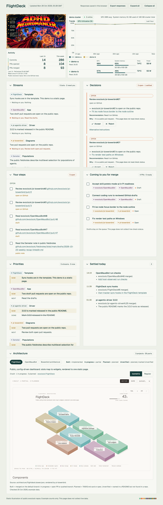

# FlightDeck demo

Static illustration of public evoclock repos. Counts in `data.json` are examples.

- Walkthrough: [assets/flock-tracker-demo.mp4](assets/flock-tracker-demo.mp4)
- Still: [demo-still.png](demo-still.png)

From the repo root, `./publish.sh` copies `assets/` to `dist/local/assets/`, including the walkthrough. The still stays beside `config.json` and `data.json`.

<video src="assets/flock-tracker-demo.mp4" controls playsinline width="100%"></video>

