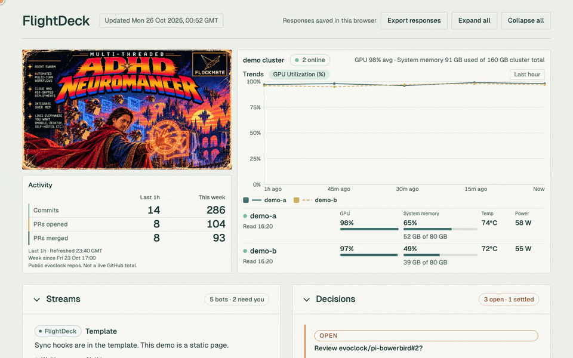

# FlightDeck

Static illustration of public evoclock repos. The page title is FlightDeck. The banner is the ADHD Neuromancer artwork. Counts in `data.json` are examples. The cluster slot is the GPU card, with demo nodes `demo-a` and `demo-b` held at 95–100% GPU. The architecture slot is `architecture.diagrams`, with pi-bowerbird diagrams of three public repos (FlightDeck, OpenMausBot, pi-bowerbird) and a Demeter stub drawn only from the public fieldnotes, under `assets/architecture/`.

- Walkthrough (mp4): [assets/flightdeck-demo.mp4](assets/flightdeck-demo.mp4)
- README preview (gif, Architecture): [assets/flightdeck-demo-readme.gif](assets/flightdeck-demo-readme.gif)
- Still (Architecture frame, 1440×900): [demo-still.png](demo-still.png)
- Architecture pane crop: [demo-architecture.png](demo-architecture.png)

From the repo root, `./publish.sh` copies `assets/` to `dist/local/assets/`, including the walkthrough. The Architecture still stays beside `config.json` and `data.json`.

Full click-through: [assets/flightdeck-demo.mp4](assets/flightdeck-demo.mp4).
